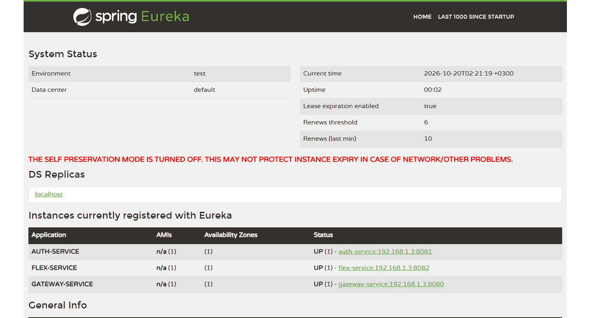
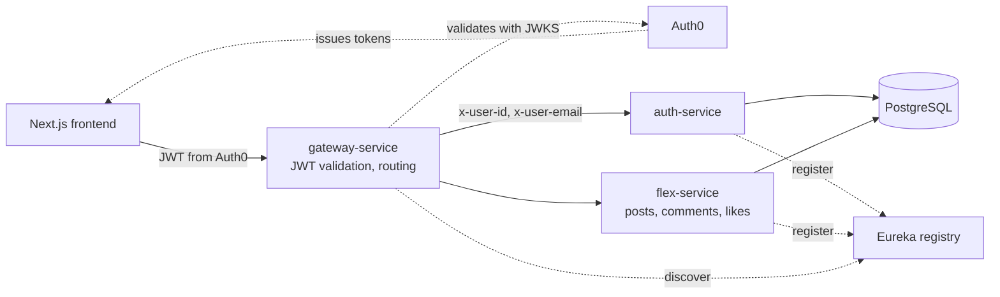
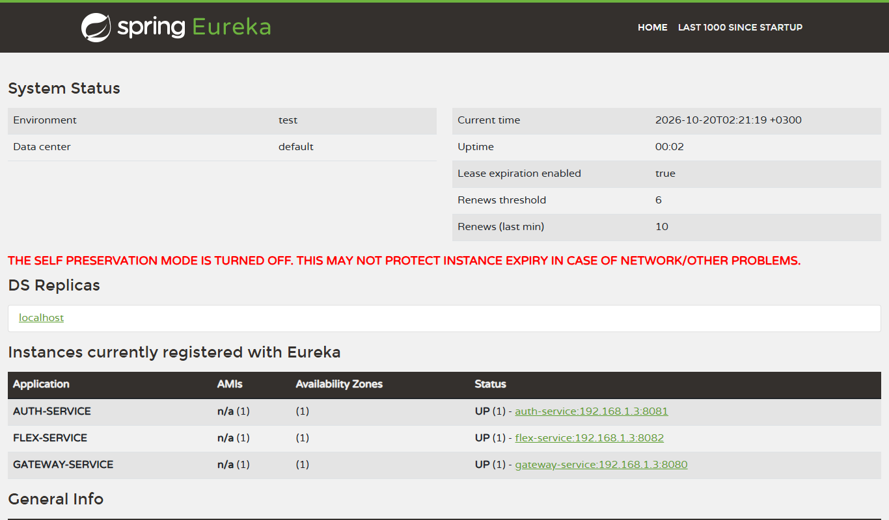
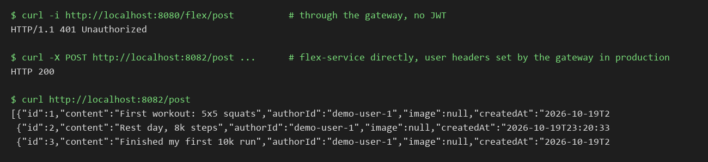

# FlexR: microservices backend for a small social app (Spring Cloud)

FlexR is a social app for sharing achievements ("flexes"): posts, likes and comments. This project was my individual assignment on **microservice architecture**: a Spring Cloud backend with service discovery, an API gateway that validates Auth0 JWTs, two business services with their own layers, a GitLab pipeline that deploys every service to Google Cloud Run, and a small Next.js frontend.



> Recorded on my machine with all four backend services running unchanged against a local PostgreSQL. The frontend needs an Auth0 tenant to log in, so it is not in the GIF (see "How to run it").

Individual project from my sixth semester (Feb to Jun 2025).

## The problem

The semester was about building software that can grow: separate deployable services, one entry point, authentication handled once, automated delivery and testing. I used a simple social feed as the domain so the time could go into the architecture.

## What it does

- **gateway-service** (Spring Cloud Gateway): single entry point on port 8080. It is an OAuth2 resource server that validates Auth0 JWTs, then forwards the user's id and email to the services as headers (`JwtClaimsForwardingFilter`). Routes `/auth/**` and `/flex/**` to the services through Eureka with client-side load balancing (`lb://`).
- **eureka** (Netflix Eureka server): service registry on port 8761; every service registers itself.
- **auth-service**: users and roles (create, update, look up by Auth0 id), PostgreSQL.
- **flex-service**: posts, comments and likes, PostgreSQL.
- In each service a `ContextFilter` turns the gateway's headers into a request-scoped `UserContext`, so the business code knows who is calling without parsing tokens itself.
- **frontend** (Next.js 15, Auth0, Tailwind): login, feed, create post, profile, an admin page for users.

## Architecture



Each service has the same layers: controller (DTOs) → business (managers behind interfaces, converters) → persistence (JPA entities, repositories).

**Delivery:** a GitLab pipeline builds every service of the Gradle multi-project, runs the auth and flex tests, builds a Docker image per service, pushes it to Google Artifact Registry and deploys each one (eureka, auth, flex, gateway, and the frontend from its own pipeline) to **Google Cloud Run**. The frontend pipeline also runs lint and GitLab's SAST and dependency scanning templates. SonarCloud is configured in the Gradle build. A Cypress end-to-end test (log in with a real Auth0 token, create a post) can be run locally.

| Service registry (Eureka) | Requests through the gateway and to the flex service |
|---|---|
|  |  |

## Tech stack

Java 17, Spring Boot 3.1, Spring Cloud (Gateway, Netflix Eureka, LoadBalancer), Spring Security OAuth2 Resource Server, Spring Data JPA, PostgreSQL, JUnit 5, Gradle multi-project · Next.js 15, React 18, Auth0, Tailwind CSS, Cypress · Docker, GitLab CI/CD, Google Cloud Run, Artifact Registry, SonarCloud.

## How to run it

Requirements: JDK 17, Docker, Node 18+.

```bash
# 1. Database
docker run -d --name flexr-db -p 5433:5432 -e POSTGRES_PASSWORD=<choose-one> postgres:16

# 2. Backend (from backend/): build all services, then start eureka first
./gradlew bootJar
export SPRING_DATASOURCE_URL=jdbc:postgresql://localhost:5433/postgres
export SPRING_DATASOURCE_USERNAME=postgres SPRING_DATASOURCE_PASSWORD=<same>
export SPRING_JPA_HIBERNATE_DDL_AUTO=update     # the repo has no schema script; this lets Hibernate create the tables
java -jar eureka/build/libs/*SNAPSHOT.jar &     # http://localhost:8761
java -jar auth/build/libs/*SNAPSHOT.jar &       # :8081
java -jar flex/build/libs/*SNAPSHOT.jar &       # :8082
java -jar gateway/build/libs/*SNAPSHOT.jar &    # :8080

# 3. Frontend (from frontend/): needs your own Auth0 tenant
cp .env.example .env.local   # fill in the Auth0 values
npm install && npm run dev   # http://localhost:3000
```

The gateway's Auth0 issuer is a placeholder in `gateway/src/main/resources/application.yml`; set it to your tenant. I ran the backend exactly like this (environment variables only, no code changes) for the GIF.

## My contribution

Individual project: I built all of it. The original backend repository has 84 commits, all mine (Feb to Jun 2025). This repository starts with a fresh history.

**About this repository:** the code is mine and has not been changed since June 2025. I packaged it for GitHub (this README, screenshots, demo GIF, removing secrets) with help from an AI assistant, which is why the single commit lists Claude as co-author.

## Status and limitations

- **The backend is the focus; the frontend is basic.** It covers login, feed, posting and an admin page, but it is not polished.
- There is no database schema or migration in the repo: the tables were created in the cloud database. Locally, `SPRING_JPA_HIBERNATE_DDL_AUTO=update` creates them.
- In the configuration both services connect to a database named `postgres`; a real "database per service" setup would separate them.
- The services trust the `x-user-*` headers, so they must only be reachable through the gateway; when you run them locally (as in the GIF) anyone can call them directly.
- **Tests:** 46 backend tests. When I ran them locally, 43 passed; the 3 that failed (`contextLoads` in auth and flex, one flex integration test) need a database configured for the test run.
- The Cypress test needs a real Auth0 test user (`cypress.env.example.json`).

## What I would change for production

- A database per service and Flyway migrations.
- Service-to-service authentication (mTLS or signed internal tokens) instead of trusting headers.
- Resilience (timeouts, retries, circuit breakers) and centralized logging/tracing across services.
- Test containers for the integration tests so they run anywhere, and contract tests between gateway and services.
